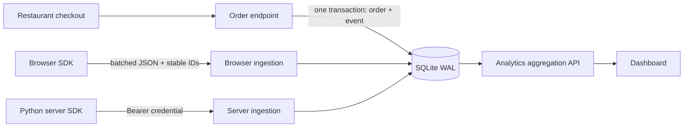

# Gather · Analytics SDK & Dashboard

A first-party analytics system with a reusable browser SDK, Python server client, validated ingestion, persistent SQLite storage, a dashboard, and an instrumented restaurant demo. Metrics are queried from stored events. There are no hardcoded metric values. This is a locally runnable engineering assignment.

## Run

Requires Python 3.11+. Node 18+ is needed only for JavaScript tests. No frontend build or external services.

```powershell
python -m venv .venv
.\.venv\Scripts\python.exe -m pip install -r requirements.txt
.\.venv\Scripts\python.exe run.py
```

On macOS/Linux use `.venv/bin/python`. If the Windows Python alias fails, use the absolute path to an installed Python for the first command.

- Dashboard: http://127.0.0.1:8000/dashboard
- Restaurant: http://127.0.0.1:8000/demo
- Interactive API: http://127.0.0.1:8000/docs
- Health check: http://127.0.0.1:8000/health

Open the restaurant, add a dish, and place a demo order. The dashboard updates every 15 seconds; **Refresh** updates immediately. Browser events usually flush within 3 seconds. All dashboard dates use **UTC**, including inclusive start/end dates. The initial empty state is intentional.

Optional: populate a disposable database with seven days of explicitly synthetic events:

```powershell
.\.venv\Scripts\python.exe -m scripts.seed --database analytics.db
```

The fixture is opt-in, uses deterministic IDs for safe re-runs on the same dates, marks every event `synthetic: true`, and creates no order records. Synthetic `order_created` events count in reports, so use a disposable database; never seed a real deployment.

## Tests

```powershell
.\.venv\Scripts\python.exe -m pytest -q
node --test tests/sdk.test.cjs
```

Tests cover deduplication, UTC boundaries, zero-filled buckets, metrics, event filters, authentication, schema/body limits, origin checks, throttling, persistence, concurrent order retries, transactional rollback, and server retries. SDK tests cover stable IDs, persistence, storage failures, opt-out, overlapping flushes, navigation, permanent rejection, and bounded unload requests.

For the optional desktop/mobile end-to-end flow, install Node dependencies and use an installed Google Chrome:

```powershell
npm.cmd ci
npm.cmd run test:browser
```

Use `npm` on macOS/Linux. The test starts its own server on port 8001 with a fresh isolated `artifacts/browser-<timestamp>.db`, exercises restaurant checkout and dashboard authentication/filtering, checks for page errors and horizontal overflow, and saves screenshots to `artifacts/`. Python dependencies must already be installed in `.venv`. `requirements-lock.txt` captures the Python versions used for validation; install it instead of `requirements.txt` for that exact dependency set.

## Architecture



FastAPI/Pydantic provide a small typed API. SQLite WAL provides transactions without infrastructure; requests use short-lived connections, and indexes support time/name filters. SQL aggregates produce bounded results. Vanilla JavaScript keeps the SDK reusable without a framework. The app factory injects database paths and credentials for isolated tests. `run.py` binds only to loopback.

## Event structure and identity

```json
{
  "events": [{
    "event_id": "d4e351c4-7e47-46a9-9aeb-3da2df1acb60",
    "name": "page_view",
    "anonymous_id": "browser-generated-uuid",
    "session_id": "tab-session-uuid",
    "occurred_at": "2026-10-23T12:00:00.000Z",
    "path": "/demo",
    "properties": {"campaign": "autumn"}
  }]
}
```

- `event_id`: producer-generated UUID, reused across retries. Primary key deduplication: first write wins even if a later payload differs. IDs are globally scoped to this single workspace.
- `anonymous_id`: required opaque identity persisted in browser localStorage. Unique visitors means `COUNT(DISTINCT anonymous_id)` across all selected events, including server events. The restaurant passes the browser ID to the server so an order does not create another visitor. Clearing storage creates a new visitor; shared browsers share identity.
- `session_id`: optional opaque identity in sessionStorage, renewed after 30 minutes of inactivity. Tabs can have different sessions. `user_id` is optional metadata, set through `identify()`. There is no anonymous-to-user or cross-device identity merging.
- `occurred_at`: timezone-aware producer time, normalized to UTC milliseconds. Reject older than 90 days or over 5 minutes ahead. `received_at` is assigned by the server. Reports use occurrence time, so delayed events change historical buckets. Slightly future events can count later in today's bucket.
- `name`: lowercase snake_case, up to 64 characters. `path`: pathname only, up to 512 characters, no query or fragment. `properties`: JSON object up to 8 KiB. Unknown top-level fields are rejected. The server assigns source based on the endpoint.

Schema: `events(event_id PK, name, anonymous_id, user_id, session_id, occurred_at, received_at, path, source, properties JSON-text)`, with indexes on occurrence time and `(name, occurred_at)`. `orders` stores order ID, unique idempotency key, request hash, anonymous ID, integer-cent total, items JSON, and timestamp. Initialization is idempotent; versioned schema migrations are out of scope.

## API

| Method | Route | Contract |
| --- | --- | --- |
| POST | `/api/v1/events` | Public browser ingestion, 1–50 events, reserved `order_created` rejected |
| POST | `/api/v1/server/events` | Same envelope; `Authorization: Bearer <ANALYTICS_SERVER_KEY>` required |
| GET | `/api/v1/analytics?start=YYYY-MM-DD&end=YYYY-MM-DD&event_name=page_view` | 1–90 inclusive UTC days, optional exact name filter; summary, daily traffic, top 20 pages, event counts, latest 30 events |
| GET | `/api/v1/menu` | Authoritative menu with prices in USD cents |
| POST | `/api/v1/orders` | `Idempotency-Key` required; body: identity and array of `{item_id, quantity}` |

Ingestion acknowledges after commit with `{"accepted": 2, "duplicates": 1}`. Validation/storage failures reject the whole batch. HTTP 422 means invalid input; 413 oversized body; 415 wrong content type; 401/403 denied access; 429 throttled with Retry-After. Transient database errors return 5xx; retry the same IDs.

Event filtering applies to all metrics and panels. Page views count `page_view`; orders count server-source `order_created`. Popular-page visitors are distinct on that page. Range-level visitors are distinct across days, not the sum of daily unique counts. Empty days have zero values. Recent activity excludes identity fields but includes non-sensitive event properties for authorized dashboard users.

## Browser SDK

```html
<script src="http://127.0.0.1:8000/static/sdk.js"></script>
<script>
  const analytics = new GatherAnalytics({
    endpoint: 'http://127.0.0.1:8000/api/v1/events',
    storageKey: 'my-app',
    enabled: true, // Set from your application's consent policy.
    autoPageViews: true
  });
  analytics.track('product_clicked', { product_id: 'bowl' });
  analytics.identify('opaque-user-42'); // Optional; never use email.
  // analytics.page(); // Custom router integration.
  // await analytics.flush();
  // analytics.setEnabled(false); // Clear unsent queue.
  // analytics.destroy(); // Remove listeners, timers, and owned history hooks.
</script>
```

Configure `ALLOWED_ORIGINS` with the embedding app's exact origin. Use a separate script file under strict CSP. Use one SDK instance per page. Auto tracking covers initial load, pushState, replaceState, and popstate; hash changes are excluded. The dashboard is not instrumented, so inspecting data does not inflate demo traffic.

Flushes occur every 3 seconds or at 10 queued events, at most 20 events / 48 KiB per request. Transport failures, 408, 429, and 5xx retain events with exponential backoff and jitter (roughly 2–60 seconds). Other 4xx discard the batch and increment `dropped`: a malformed event can discard its entire batch. `failures`, `dropped`, and `storageAvailable` expose integration diagnostics.

The queue persists in localStorage, bounded to 200 events with oldest eviction; events older than 7 days are discarded on reload. Storage denial falls back to memory. Opt-out clears unsent events; it cannot recall in-flight requests or delete past records. On visibility becoming hidden, bounded fetch with `keepalive` attempts delivery. IDs remain until acknowledged, so interrupted acknowledgments may safely retry. Delivery at unload remains best effort; see [MDN keepalive documentation](https://developer.mozilla.org/en-US/docs/Web/API/Request/keepalive).

## Server SDK and order correctness

```python
from analytics_app.server_sdk import AnalyticsClient, business_event

client = AnalyticsClient('http://127.0.0.1:8000', server_key='your-secret')
event = business_event('reservation_created', anonymous_id='browser-generated-uuid',
                       session_id='tab-session-uuid', properties={'party_size': 4})
client.send(event)
```

The helper has timeouts and bounded retries on transport errors, 429, and 5xx with the same event ID. Permanent failures or retry exhaustion raise to the caller. It is synchronous; use a worker/thread outside an async loop. For reliable external business tracking, persist a transactional outbox alongside business data, then dispatch from a worker. This helper alone is not a durable outbox.

The restaurant instead writes its order and analytics event **in one SQLite transaction**. Prices come from the server catalog, quantities are bounded, and totals use integer cents. `BEGIN IMMEDIATE` serializes concurrent idempotency checks. Repeating the same key and exact input returns the existing order; changed input returns 409. The UI retains key/payload after ambiguous network failures and locks cart changes until retry resolves. Pending orders survive retries in that tab, not a reload. Payments, inventory, delivery, and customer accounts are excluded.

## Configuration and security

| Variable | Default / purpose |
| --- | --- |
| `DATABASE_PATH` | `analytics.db` in the working directory |
| `DASHBOARD_TOKEN` | Unset: reporting restricted to loopback clients; set for remote deployments |
| `ANALYTICS_SERVER_KEY` | Unset: remote server ingestion disabled; transactional restaurant events still work |
| `ALLOWED_ORIGINS` | `http://127.0.0.1:8000,http://localhost:8000`; exact comma-separated origins |

PowerShell configuration before starting:

```powershell
$env:DASHBOARD_TOKEN = 'replace-with-a-long-random-secret'
$env:ANALYTICS_SERVER_KEY = 'replace-with-a-different-long-random-secret'
.\.venv\Scripts\python.exe run.py
```

The dashboard prompts for its token and stores it in sessionStorage for the tab. Server credentials never appear in browser code. Hosted use needs HTTPS and stronger user authentication. Always set `DASHBOARD_TOKEN` behind a reverse proxy: loopback proxy connections can bypass the local-only default. Public browser ingestion and the demo order API are not authenticated; origin restrictions are a browser boundary, not protection against arbitrary clients. Browser events must not be trusted for billing/auditing.

Mutation bodies are streamed with a 256 KiB ceiling and must be JSON. Process-local throttling permits 120 API requests/minute/client IP per reporting vs other-API bucket, with a bounded 10,000-entry map. Forwarded IP headers are ignored; a proxy can group multiple users under one limit. CORS restricts browser origins. CSP restricts scripts/framing, frontend rendering uses text nodes, and SQL values are parameterized.

The optional Swagger `/docs` page uses FastAPI's standard CDN assets and a scoped CSP exception for its inline initializer. The dashboard, restaurant, and SDK have no external asset dependencies. Raw API schema is available offline at `/openapi.json`.

No IPs or user agents are persisted. Query strings/fragments are excluded. Common credential/personal property keys are rejected recursively, but sensitive values/path segments can still be sent: integrators must sanitize data. The demo offers browser opt-out; server-created order records/events continue as business records. This is not a regulatory consent or deletion implementation.

## Limitations and next steps

- Single workspace and SQLite file, intended for modest traffic. No load-test claim. WAL and a 10-second busy timeout reduce contention; writes still serialize. At scale use PostgreSQL, queued ingestion, and aggregate rollups.
- Browser delivery is at-least-once **attempted** with idempotent persistence, not lossless. Overflow, storage clearing, crashes, permanent rejection, clock errors, and ad blockers can lose events. localStorage updates can race across tabs; IndexedDB per-event records would improve durability.
- No RBAC, project isolation, audit trail, durable rate limiter, bot classification, export/deletion, retention job, or versioned migrations. The age acceptance window does not delete stored rows.
- Dashboard polls rather than pushes. UTC only, no comparison-period percentages or unsupported engagement claims. Every request computes aggregates over its range; top pages/activity are bounded.
- Global first-write-wins deduplication does not audit conflicting payloads. A malicious producer knowing an event UUID could preempt it; authenticated tenant namespaces and conflict logging are future work.
- Unit/integration tests do not replace browser visual/accessibility, cross-browser, production load, or security review.

Framework reference: [FastAPI TestClient](https://fastapi.tiangolo.com/tutorial/testing/).
